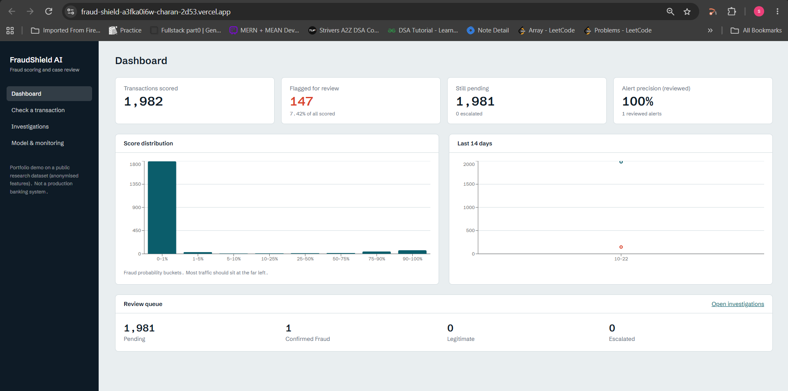
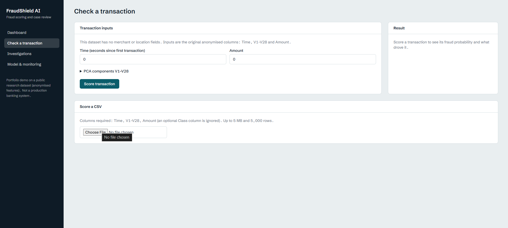
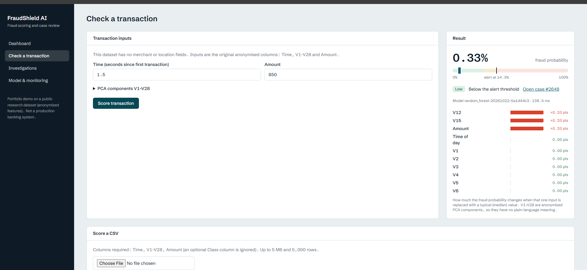
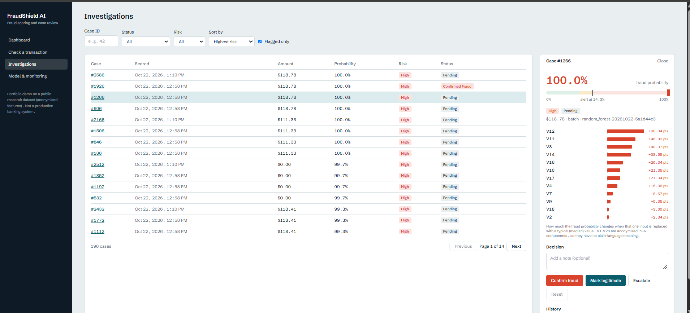
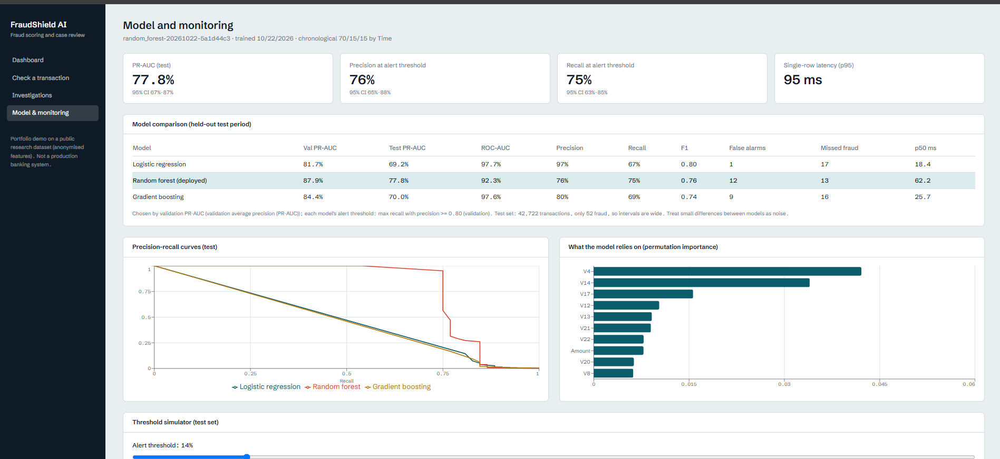
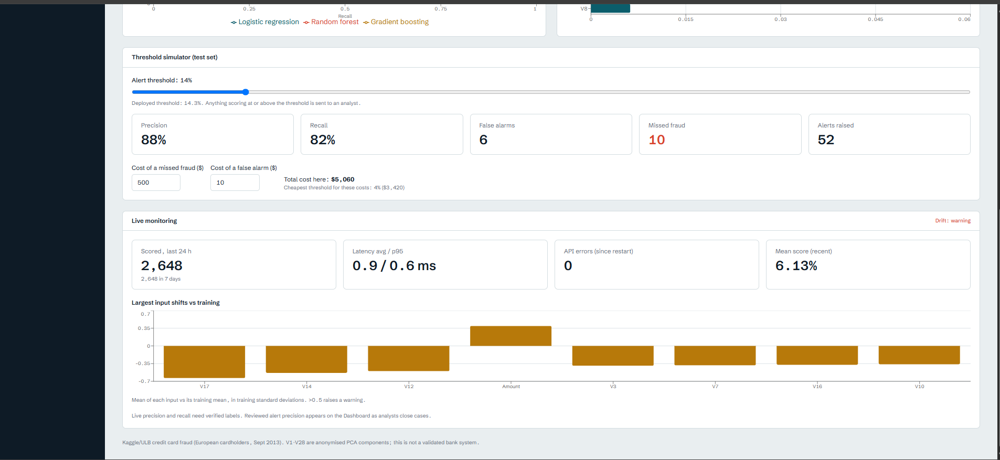

# FraudShield AI — Full-Stack Credit Card Fraud Detection & Investigation Platform

An end-to-end machine learning application for detecting potentially fraudulent credit card transactions, scoring individual transactions and CSV batches, and managing flagged cases through an investigation workflow.

**[Live Demo](https://fraud-shield-a3fka0i6w-charan-2d53.vercel.app) · [GitHub Repository](https://github.com/Charan-dev247/FraudShield-AI)**

> **Disclaimer:** FraudShield AI is a portfolio demonstration built using an anonymized credit card transaction dataset. It is not a production banking or payment-processing system.

---

## Table of Contents

- [Overview](#overview)
- [Live Application Screenshots](#live-application-screenshots)
- [Key Features](#key-features)
- [Application Workflow](#application-workflow)
- [System Architecture](#system-architecture)
- [Machine Learning Models](#machine-learning-models)
- [Model Evaluation](#model-evaluation)
- [Threshold Simulation](#threshold-simulation)
- [Technology Stack](#technology-stack)
- [Project Structure](#project-structure)
- [Getting Started](#getting-started)
- [API Documentation](#api-documentation)
- [Limitations and Future Improvements](#limitations-and-future-improvements)

## Overview

Credit card fraud detection is a challenging machine learning problem because fraudulent transactions are rare compared with legitimate transactions. A useful detection system must identify suspicious activity while balancing missed fraud against false alarms.

FraudShield AI combines a machine learning inference service with an interactive web application to demonstrate how a fraud detection workflow can operate.

The application allows users to:

- Score individual transactions and obtain fraud probability estimates.
- Upload CSV files for batch transaction scoring.
- Flag transactions for investigation based on a configurable alert threshold.
- Review flagged cases and record investigation decisions.
- Compare multiple machine learning models using held-out test results.
- Explore precision-recall trade-offs, threshold simulations, latency, and input drift indicators.

The project uses the Kaggle/U​​LB credit card fraud dataset, which contains anonymized principal component analysis (PCA) features rather than identifiable merchant or location details.

## Live Application Screenshots

### 1. Dashboard

The dashboard provides an overview of scored transactions, alerts, pending investigations, and the current review queue.



### 2. Transaction Scoring

Users can enter the transaction time, amount, and anonymized PCA components to obtain a fraud probability estimate.



### 3. Fraud Probability and Feature Contributions

The scoring result displays the estimated fraud probability, risk classification, configured alert threshold, and feature-contribution information.



### 4. Investigation Management

The investigations interface supports filtering and sorting cases, inspecting individual predictions, and recording decisions such as confirmed fraud, legitimate, or escalated.



### 5. Model Comparison and Evaluation

The model comparison dashboard displays validation and test PR-AUC, ROC-AUC, precision, recall, F1 score, false alarms, missed fraud, and inference latency.



### 6. Threshold Simulation and Live Monitoring

The monitoring dashboard includes a threshold simulator, estimated alerting trade-offs, recent scoring activity, latency and API error indicators, and input-shift monitoring.



## Key Features

### Transaction Scoring

- Single-transaction inference through a FastAPI backend.
- Fraud probability estimation using the deployed Random Forest model.
- Configurable alert threshold for deciding which transactions should be reviewed.
- Risk classification and feature-contribution displays.
- Recorded scoring latency.

### CSV Batch Inference

- Upload CSV files for batch scoring.
- Support for up to 5 MB and 5,000 rows per upload.
- Required columns: `Time`, `V1`–`V28`, and `Amount`.
- Optional `Class` column is ignored during inference.
- Batch results include scored transactions and flagged cases.

### Investigation Workflow

- Automatic case creation for scored transactions.
- Case listing, filtering, and sorting by risk or status.
- Individual case details, probability scores, and feature contributions.
- Investigation actions for confirming fraud, marking a transaction legitimate, or escalating a case.
- Review status tracking.

### Model Evaluation

- Comparison of Logistic Regression, Random Forest, and Gradient Boosting.
- Chronological train, validation, and test splits.
- Precision-recall and ROC-AUC evaluation.
- Threshold selection based on validation performance.
- Comparison of false alarms, missed fraud, F1 score, and latency.

### Monitoring and Threshold Analysis

- Configurable alert threshold simulation.
- Precision and recall estimates at different thresholds.
- Estimated costs associated with missed fraud and false alarms.
- Recent scoring volume and latency indicators.
- API error and input-distribution shift indicators.

## Application Workflow

1. A user enters a transaction or uploads a CSV file.
2. The React frontend sends the input to the FastAPI backend.
3. The backend validates the input and passes the required features to the deployed machine learning model.
4. The model produces a fraud probability estimate.
5. The probability is compared with the configured alert threshold.
6. Transactions meeting the threshold are flagged for review and associated with investigation cases.
7. Reviewers inspect cases and update their investigation status.
8. The dashboard and monitoring pages display scoring activity, model evaluation, and threshold-related metrics.

## System Architecture

```text
                 React + TypeScript
                     Frontend
                         |
                         | HTTP / REST API
                         v
                    FastAPI Backend
                         |
             +-----------+-----------+
             |                       |
             v                       v
      Input Validation        SQLAlchemy ORM
             |                       |
             v                       v
      Random Forest Model      Application Database
             |
             v
       Fraud Probability
             |
             v
      Threshold Evaluation
             |
        +----+----+
        |         |
        v         v
     Low Risk   Flagged Case
                   |
                   v
             Investigation UI
```

The frontend is deployed on Vercel, while the backend API is deployed on Render.

## Machine Learning Models

Three classification models were trained and evaluated:

- **Logistic Regression:** A linear classification baseline.
- **Random Forest:** An ensemble of decision trees selected for deployment based on validation PR-AUC.
- **Gradient Boosting:** A boosting-based classification model used for comparison.

### Dataset

The project uses the anonymized Kaggle/U​​LB credit card fraud dataset.

| Property | Details |
|---|---|
| Input features | `Time`, `V1`–`V28`, `Amount` |
| Target label | `Class` |
| Class 0 | Non-fraudulent transaction |
| Class 1 | Fraudulent transaction |
| Split strategy | Chronological split by `Time` |

The displayed held-out test set contains 42,722 transactions, including 52 fraudulent transactions. The training and validation sets contain 199,364 and 42,721 transactions, respectively.

### Data Splitting

The dataset was divided chronologically into training, validation, and test partitions to reduce the risk of using future transactions to select the model.

| Partition | Transactions | Fraud cases |
|---|---:|---:|
| Training | 199,364 | 384 |
| Validation | 42,721 | 56 |
| Test | 42,722 | 52 |

The validation set was used for model selection and alert-threshold selection. The held-out test set was used to report final comparison metrics.

## Model Evaluation

The following values are taken from the deployed Model & Monitoring dashboard.

| Model | Validation PR-AUC | Test PR-AUC | ROC-AUC | Precision | Recall | F1 |
|---|---:|---:|---:|---:|---:|---:|
| Logistic Regression | 81.7% | 69.2% | 97.7% | 97% | 67% | 0.80 |
| **Random Forest (deployed)** | **87.9%** | **77.8%** | 92.3% | 76% | 75% | 0.76 |
| Gradient Boosting | 84.4% | 70.0% | 97.6% | 80% | 69% | 0.74 |

Random Forest was selected because it achieved the highest validation PR-AUC among the three evaluated models.

Its reported held-out test PR-AUC is **77.8%**, with approximately **76% precision** and **75% recall** at the deployed operating threshold.

### Why PR-AUC Matters

Fraud detection datasets are highly imbalanced. Precision-recall metrics help evaluate the trade-off between identifying fraudulent transactions and generating false alarms.

- **Precision:** The fraction of flagged transactions that are fraudulent.
- **Recall:** The fraction of fraudulent transactions that are flagged.
- **F1 score:** The harmonic mean of precision and recall.
- **PR-AUC / Average Precision:** Summarizes precision-recall performance across score thresholds.
- **ROC-AUC:** Measures ranking performance across false-positive and true-positive rates.

The test set contains only 52 fraud cases, so individual predictions can noticeably affect the reported metrics. These results should be interpreted with that limitation in mind.

## Threshold Simulation

The application includes a threshold simulator to demonstrate how changing the alert threshold affects the fraud review process.

The deployed threshold shown in the application is approximately **14.3%**.

The dashboard also displays a simulation at a threshold of approximately 14%, with these illustrative test-set results:

| Metric | Displayed result |
|---|---:|
| Precision | 88% |
| Recall | 82% |
| False alarms | 6 |
| Missed fraud | 10 |
| Alerts raised | 52 |

The simulator also allows users to adjust the assumed costs of a missed fraud and a false alarm to compare estimated operational costs across thresholds.

These are threshold-simulation results, not guarantees of future performance. They depend on the evaluated dataset and the selected cost assumptions.

## Technology Stack

| Layer | Technologies |
|---|---|
| Frontend | React, TypeScript, Vite |
| Styling | Tailwind CSS |
| Backend | Python, FastAPI |
| Machine Learning | scikit-learn, NumPy, pandas |
| Database layer | SQLAlchemy |
| Model evaluation | Precision-recall metrics, ROC-AUC, F1 |
| API testing | FastAPI Swagger UI |
| Frontend deployment | Vercel |
| Backend deployment | Render |
| Version control | Git, GitHub |

## Project Structure

```text
Credit_Card_Fraud_Detection/
├── .github/
├── backend/
│   ├── app/
│   ├── tests/
│   ├── Dockerfile
│   └── requirements.txt
├── data/
├── frontend/
│   ├── src/
│   ├── public/
│   ├── package.json
│   └── vite.config.ts
├── NoteBook/
├── screenshots/
│   ├── dashboard.png
│   ├── check_transaction.png
│   ├── input_transaction.png
│   ├── investigation.png
│   ├── model_1.png
│   └── model_2.png
├── docker-compose.yml
├── .gitignore
└── README.md
```

The exact contents of the backend and frontend directories may evolve as the project is extended.

## Getting Started

### Prerequisites

Install the following tools:

- Python 3.10 or a compatible version supported by the backend dependencies.
- Node.js and npm.
- Git.

### 1. Clone the Repository

```bash
git clone https://github.com/Charan-dev247/FraudShield-AI.git
cd FraudShield-AI
```

### 2. Configure the Backend

Open a terminal in the repository root:

```bash
cd backend
python -m venv .venv
```

Activate the virtual environment.

**Windows PowerShell**

```powershell
.\.venv\Scripts\Activate.ps1
```

**macOS / Linux**

```bash
source .venv/bin/activate
```

Install dependencies:

```bash
pip install -r requirements.txt
```

Configure any required environment variables according to the backend settings and available model artifacts.

Start the API using the application module:

```bash
uvicorn app.main:app --reload
```

The backend should now be available at:

`http://127.0.0.1:8000`

### 3. Configure the Frontend

Open a second terminal from the repository root:

```bash
cd frontend
npm install
```

Create a local `.env` file in the `frontend` directory:

```env
VITE_API_URL=http://127.0.0.1:8000
```

Start the frontend:

```bash
npm run dev
```

Open the local URL printed by Vite, usually:

`http://localhost:5173`

### 4. Run Tests

From the backend directory, activate the virtual environment and run:

```bash
python -m pytest -q
```

The current development test suite previously completed with **13 passing tests**. Results may differ as the repository changes.

Build the frontend for production:

```bash
cd frontend
npm run build
```

**Note:** The backend may require trained model artifacts and other configuration files to be present. Follow the repository's current setup instructions if these are not included in the clone.

## API Documentation

When the backend is running locally, FastAPI provides interactive API documentation at:

- Swagger UI: `http://127.0.0.1:8000/docs`
- Health endpoint: `http://127.0.0.1:8000/health`

The deployed backend health endpoint is available at:

https://fraudshield-ai-x5ba.onrender.com/health

The backend provides the API functionality used by the frontend for scoring, batch inference, investigations, model metrics, and monitoring.

## Limitations and Future Improvements

### Current Limitations

- **Anonymized inputs:** The PCA components do not provide human-readable merchant, location, or transaction-category information.
- **Class imbalance:** The test partition contains only 52 fraud cases, limiting the precision of performance estimates.
- **Demo deployment:** The application is intended for portfolio demonstration, not production financial decisions.
- **Authentication:** The current demo does not implement a complete authentication and authorization system.
- **Data persistence:** Persistence depends on the configured database and hosting environment. Local storage on a free hosting instance may be ephemeral.
- **Monitoring:** Live monitoring indicators should not be interpreted as proof of ongoing production model performance.

### Future Improvements

- Add authentication and role-based access control for investigators and administrators.
- Configure persistent database storage for durable case and transaction history.
- Add more extensive API validation, rate limiting, and security controls.
- Improve experiment tracking and model version management.
- Add automated retraining and model evaluation pipelines.
- Expand drift monitoring and investigate alerts using verified labels.
- Add explainability techniques suited to anonymized PCA features.
- Evaluate the system on additional datasets and more fraud examples.

## Acknowledgements

- **Dataset:** Kaggle/U​​LB Credit Card Fraud Detection dataset.
- **Machine learning:** scikit-learn.
- **Backend API:** FastAPI.
- **Frontend:** React and Vite.

---

**Built as a full-stack machine learning portfolio project demonstrating fraud scoring, model evaluation, batch inference, and investigation workflows.**
